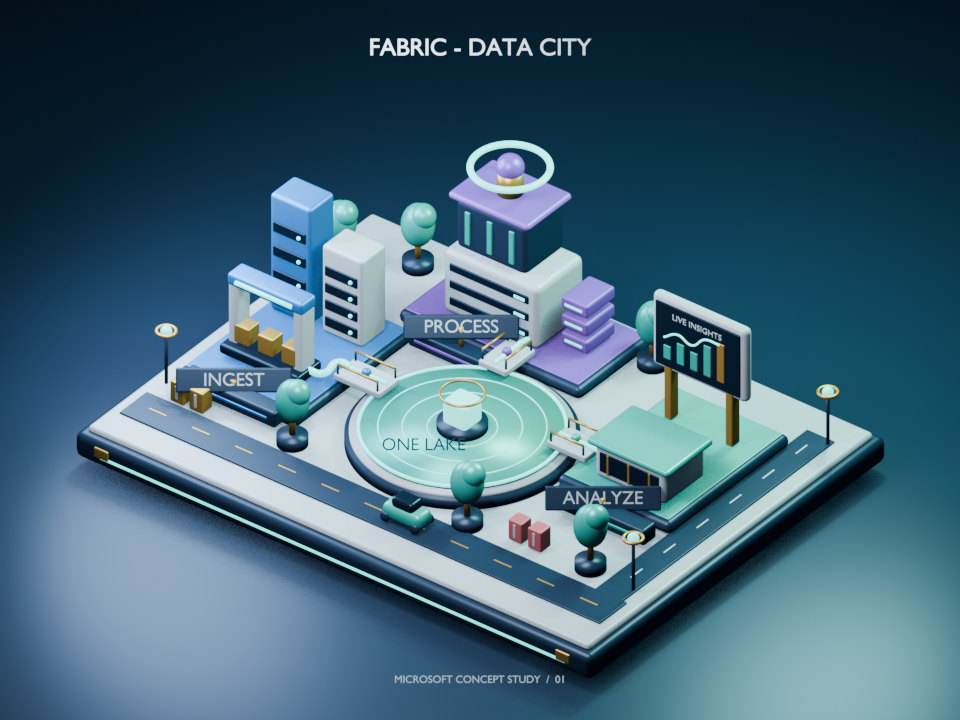
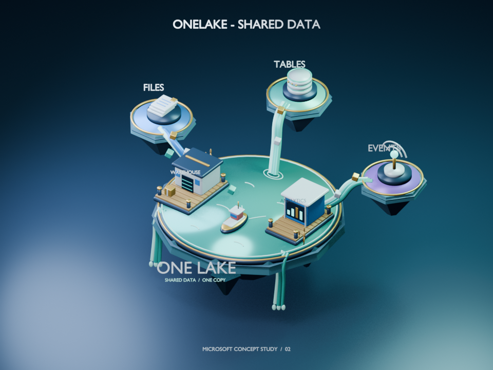
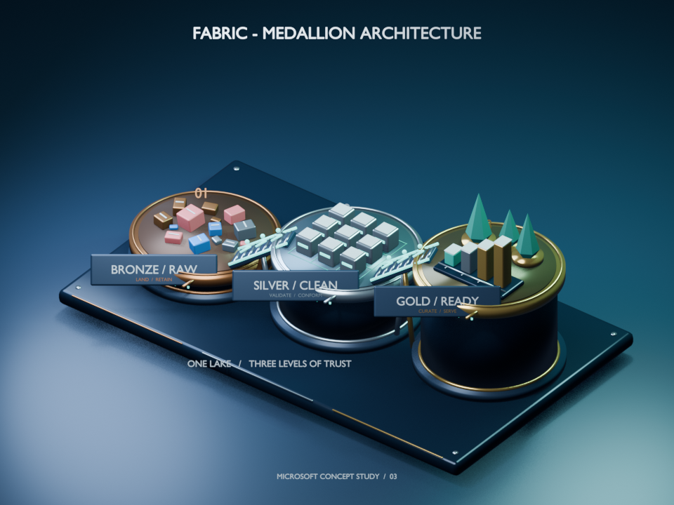
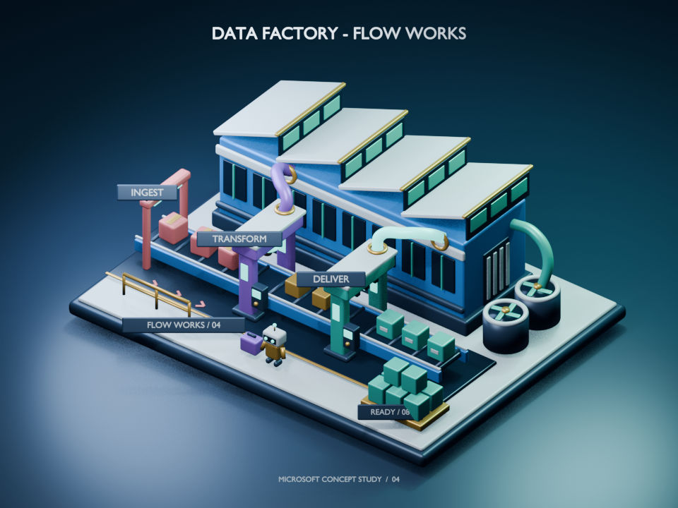
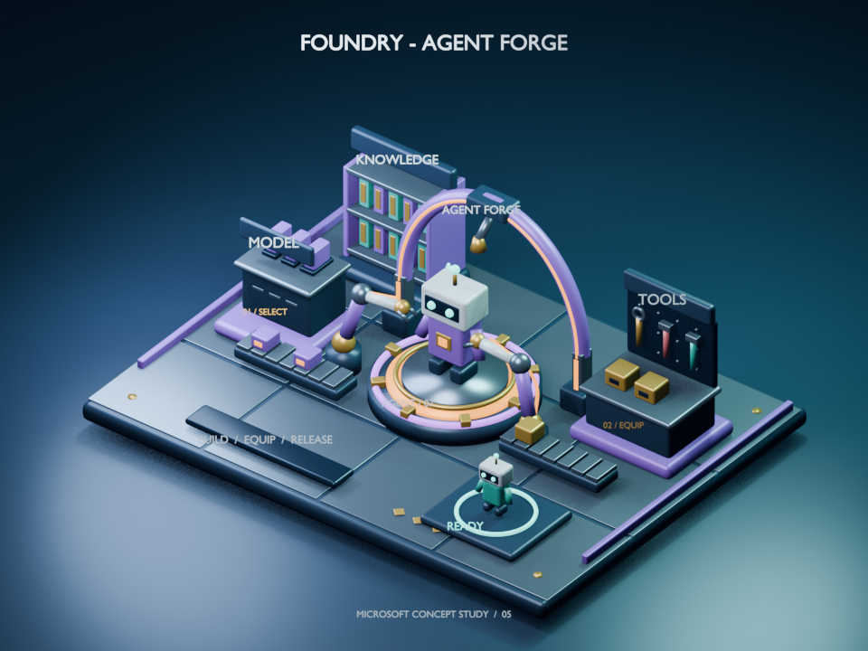
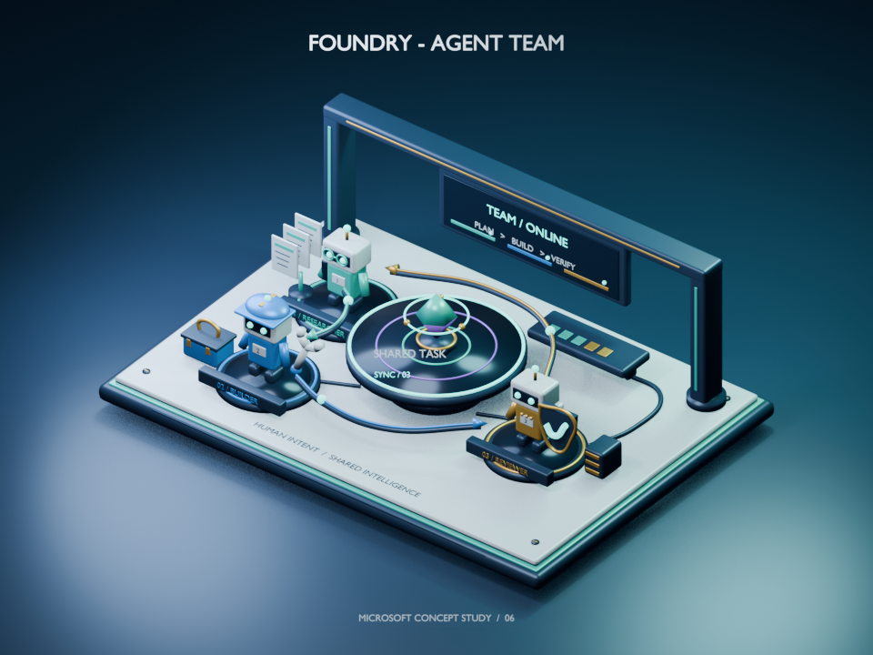
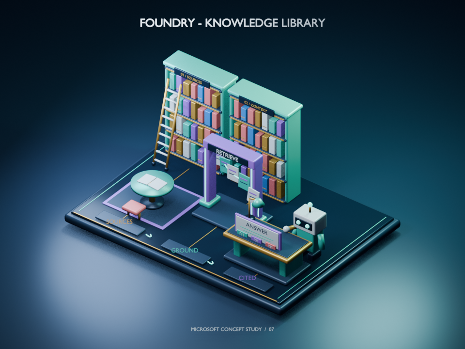
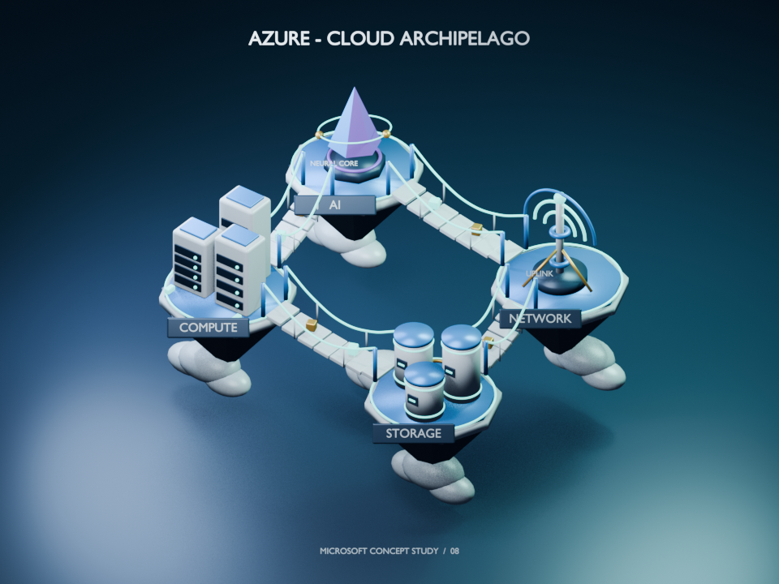
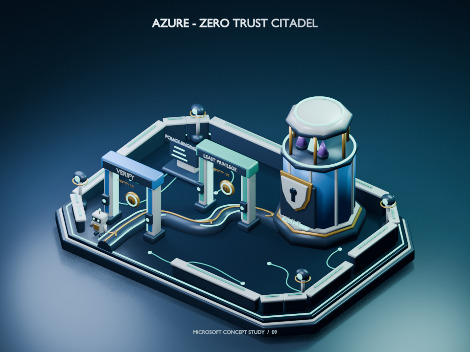
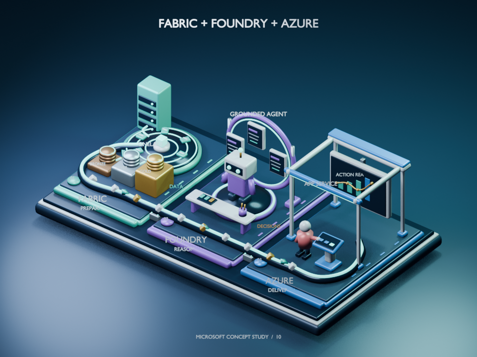

# Blender + GitHub Copilot in VS Code

A practical experiment in controlling Blender through natural-language prompts,
comparing **Model Context Protocol (MCP)** tools with **direct Python API (`bpy`)**
scripts. Includes reproducible tests, example scenes, and observed AI usage costs.

This is an independent experiment, not an official Blender or GitHub integration.

**[Explore the interactive 3D gallery](https://faustinopalma.github.io/blender-copilot-lab/web/)**:
ten orbitable, zoomable dioramas, hosted on GitHub Pages. No Blender or Copilot
subscription is required to view them. You can also
[run the gallery locally](#interactive-browser-gallery).

<a href="output/coding-cat.png"></a>

*The original coding-cat test subject; click for the full-size render.*

## What it does

The integration lets a Copilot agent inspect a Blender scene, change geometry,
materials, lighting or cameras, render a preview, and evaluate the result.

```text
Interactive: Copilot -> MCP server -> local Blender addon -> bpy
Batch:       local script -> Blender Python interpreter -> bpy
```

MCP provides the connection and tools; it is not a separate 3D generation model.
Use it for interactive **inspect -> modify -> render -> verify** workflows.
Use direct Python scripts for predefined operations and batch rendering.

Blender runs locally, but Copilot model requests use cloud inference. Local
rendering does not make the overall workflow offline.

## What we learned

- **MCP is the useful interactive layer; `bpy` does the work.** Both paths
  produced the same scene and effectively identical images. Use MCP for
  inspection and feedback, direct scripts for repeatable batch operations.
- **One shared scene means sequential agents.** All ten dioramas were created
  one at a time. Independent parallel work would need separate Blender instances
  and ports; it was not tested.
- **Fresh agents prevent cumulative conversation growth, not cache effects.**
  Starting contexts differed by only 73 tokens, while 97.72% of aggregate input
  was cache reads. A later subject is not automatically more expensive.
- **Count the full loop.** Each gallery subject includes its initial creation
  and one correction. The ten child agents consumed 223.89157 credits
  (about $2.24 equivalent) over 79 min 32 s of summed agent runtime. Coordination,
  installation, documentation, and website development are separate.
- **The result is reusable 3D geometry.** All ten GLBs loaded in the browser
  with working orbit, zoom, pan, and reset. Their combined size is 17.36 MiB.
  Export and viewing do not themselves require AI inference.
- **A browser is not Blender's renderer.** PBR materials transfer, but EEVEE
  lighting is not baked. Orbitable models and studio PNGs serve complementary
  purposes, and some labels are best read from the intended front view.

The detailed measurements below separate inference accounting, MCP phase
timings, independent export/validation, and browser checks rather than presenting
them as one interchangeable performance score.

## Installation

The supplied launcher and configuration target **Windows**. Other operating
systems require adapting paths and launch commands; they were not tested.

### 1. Install prerequisites

- [Blender](https://www.blender.org/download/).
- [VS Code](https://code.visualstudio.com/) with GitHub Copilot and MCP support.
- Python 3.13, [Git](https://git-scm.com/), and
  [uv](https://docs.astral.sh/uv/getting-started/installation/).
- A Copilot plan or allowance that supports the selected model and agent tools.

Clone this repository and open its root directory in VS Code. Run the following
commands in PowerShell from that directory. Do not install `bpy` into the host
Python environment: the scripts use Blender's own Python interpreter.

```powershell
git clone https://github.com/faustinopalma/blender-copilot-lab.git
Set-Location .\blender-copilot-lab
```

### 2. Download the pinned MCP source

The experiment uses
[ahujasid/mcp-for-blender](https://github.com/ahujasid/mcp-for-blender), version
2.1.9, at a fixed revision:

```powershell
git -c core.autocrlf=false clone --no-checkout https://github.com/ahujasid/mcp-for-blender.git .\vendor\mcp-for-blender
if ($LASTEXITCODE -ne 0) { throw 'Source download failed' }
git -C .\vendor\mcp-for-blender checkout --detach 7a0373ec9199183cb460068c4f96aed9c579fb4f
if ($LASTEXITCODE -ne 0) { throw 'Pinned revision checkout failed' }
```

This upstream was selected for its substantially larger adoption and active
development. Alternatives were researched, but only this server was executed.
See the [candidate comparison](results/candidates.json).

The `vendor` directory is ignored by Git and must be populated during setup.
Existing installations can skip this step if the pinned source is already present.

### 3. Add the local telemetry configuration

The pinned source checkout omits a configuration module needed by its telemetry
code. Before building, create
`vendor\mcp-for-blender\src\blender_mcp\config.py` with:

```python
from dataclasses import dataclass

@dataclass
class TelemetryConfig:
    enabled: bool = False
    max_prompt_length: int = 1000
    timeout: float = 3.0
    supabase_url: str = ""
    supabase_anon_key: str = ""
    supabase_bucket: str = ""

telemetry_config = TelemetryConfig()
```

This is a local build configuration with collection disabled and no external
endpoint. It does not change the upstream addon or server functions.

### 4. Install dependencies in a virtual environment

The [lockfile](requirements-lock.txt) records the tested Windows dependencies.
Its MCP source entry contains a machine-specific path, so install the pinned
dependencies separately and build the server from the local checkout:

```powershell
uv venv --python 3.13 .venv
if ($LASTEXITCODE -ne 0) { throw 'Virtual environment creation failed' }

$packages = Get-Content .\requirements-lock.txt |
    Where-Object { $_ -and $_ -notmatch '^mcp-for-blender\s*@' }
uv pip install --python .\.venv\Scripts\python.exe $packages
if ($LASTEXITCODE -ne 0) { throw 'Dependency installation failed' }

uv pip install --python .\.venv\Scripts\python.exe --no-deps --no-build-isolation .\vendor\mcp-for-blender
if ($LASTEXITCODE -ne 0) { throw 'Local server build failed' }
uv pip check --python .\.venv\Scripts\python.exe
if ($LASTEXITCODE -ne 0) { throw 'Dependency validation failed' }
```

Use official package sources and keep HTTPS verification enabled. The recorded
experiment verified all 33 downloaded dependency wheels against official PyPI
SHA-256 metadata before installing them. The [verification script](scripts/verify_wheels.py)
and [provenance record](results/wheel-provenance.json) are included.
To reuse a verified local `wheelhouse`, add `--no-index --find-links .\wheelhouse`
to dependency installation. That directory is not included in Git.

### 5. Configure paths and start Blender

Update the existing absolute paths for your machine:

- [MCP configuration](.vscode/mcp.json): virtual-environment Python, wrapper
  script, addon directory, and workspace-local data directories.
- [Launcher](scripts/start-blender.ps1): Blender executable location.
- [VS Code tasks](.vscode/tasks.json): Blender executable location.
- Optional [palette](scripts/example_palette.py) and
  [loop](scripts/example_loop_01.py) replay scripts: input/output paths, including
  those in [cycle 2](scripts/example_loop_02.py) and [cycle 3](scripts/example_loop_03.py).

Then start the isolated Blender session:

```powershell
& .\scripts\start-blender.ps1
```

Keep it running. The launcher uses separate user resources, loads the pinned
addon for that process, and listens on `127.0.0.1:9876`. It reopens the example
scene when available, otherwise starts a disposable scene. No global addon
installation is required. The upstream bridge needs a Blender GUI; it does not
serve commands in background mode.

In VS Code, open **MCP: List Servers**, start `blender-local`, and approve trust
if prompted. Enable its tools in Agent chat. If tools are not visible, start a
new chat or reload the window. Do not bypass tool approvals.

Start with: **"Use blender-local to inspect the addon and scene. Do not modify
anything."**

## Tests performed

Recorded on **October 16, 2026** using Blender **5.2.2 LTS ARM64**, host Python
**3.13.13 AMD64 on Windows ARM64**, MCP server **2.1.9**, and MCP SDK **1.30.0**.
Native Copilot tool calls and an SDK-based MCP client both reached Blender.

The test subject is an original six-tentacled coding cat, not a reproduction of
the official GitHub mascot. No external models, logos, or textures were used.

| Test group | Passed | Coverage |
| --- | ---: | --- |
| MCP integration | 18 | Discovery, scene creation, inspection, edits, error recovery, safety checks, images, saving, GLB export, keyframes |
| Baseline output validation | 9 | Reopening saved scenes, geometry, nonblank images, pixel comparison |
| Additional example validation | 9 | Palette isolation, framing target, unchanged originals, stable final render |
| Unit tests | 26 | Local-network guard, usage accounting, billing reconciliation |
| Microsoft gallery | 10 scenes | Reopening, geometry, images, source hashes, self-contained GLB exports |
| Browser gallery | 10 models | Real WebGL loading; orbit, zoom, pan, reset, mobile layout, error recovery |

The direct API and MCP runs produced matching 62-object scene snapshots.
Their 640 x 640 renders had a mean absolute pixel error of **2.234e-8**
on normalized channels, below the tested **0.01** threshold.

### Observed timings

| Operation | Direct `bpy` | MCP |
| --- | ---: | ---: |
| Build the scene | 0.585 s | 1.979 s |
| Read 62 names and positions, median of 20 samples | 0.042 ms | 66.548 ms |
| Render at 640 x 640 | 8.838 s | 4.937 s |

These are **not equivalent process/cache conditions**: direct measurements use a
new background Blender process; MCP uses an already-running GUI. Direct reads
are in-process, while MCP timings include transport and validation. Rendering
differences do not demonstrate that MCP accelerates Blender.

Evidence: [direct API](results/direct.json), [MCP](results/mcp.json),
[baseline validation](results/validation.json), and
[example validation](results/examples/validation.json).

## Observed AI costs

Blender and the open-source MCP server have no per-call software charge.
Rendering uses local hardware; electricity was not measured. Copilot inference
consumes AI credits according to model, tokens, images, and cache usage.
External asset-generation services were disabled and are not included.

Two separate subagents executed the examples **sequentially**, using GPT-6.1 Sol:

| Example | Model calls | Full subagent runtime | AI credits | USD equivalent |
| --- | ---: | ---: | ---: | ---: |
| Purple material variant | 17 | 249.424 s | 43.49892 | $0.4349892 |
| Three-iteration framing loop | 17 | 267.222 s | 29.59857 | $0.2959857 |
| **Total** | **34** | **516.646 s** | **73.09749** | **$0.7309749** |

These are complete **local runtime accounting records, not invoices**.
The conversion used is **1 AI credit = $0.01 USD**, as documented on the test
date. Included plan allowances may cover the consumption without an additional
charge. Subscription fees, the coordinating agent, documentation, and subsequent
independent validation are excluded from this table.

The initial end-to-end setup and API/MCP evaluation separately reported
**129.83701 credits**, or **$1.2983701** equivalent. That includes research,
installation, script development, retries, and testing, not just scene generation.

The [usage report](results/examples/usage.json) separates subagent consumption
from the parent. The [metering script](scripts/measure_usage.py) deduplicates
records, excludes duplicate checkpoint totals, and treats missing measurements
as unknown rather than zero. Its input is runtime-specific, not a guaranteed
public billing API. Check GitHub billing for account-level charges.

### What a loop costs

The framing experiment ran three separate **measure -> adjust -> render ->
inspect** cycles, targeting 78% character occupancy with a two-percentage-point
tolerance:

| Iteration | Occupancy | Outcome |
| --- | ---: | --- |
| 1 | 60.63% | Increase character size in frame |
| 2 | 78.00% | Target reached without clipping |
| 3 | 78.00% | Verification; pixels identical to iteration 2 |

Its **29.60 credits** total averages **9.87 credits per iteration**, including
setup. This is not an isolated marginal price per cycle or a general estimate.
The loop reused more cached context than the palette example; the tasks also
differ. A production loop could stop at the second iteration once converged.

Control costs with small previews, compact tool output, numerical targets,
iteration limits, and early stopping. A Python batch loop without model
decisions between iterations does not incur an AI request for every render.

Pricing references:
[GitHub AI credits](https://docs.github.com/en/copilot/concepts/billing-and-usage/individuals/billing)
and [model pricing](https://docs.github.com/en/copilot/reference/copilot-billing/models-and-pricing).
Rates and plan allowances may change.

## Example prompts

For modifying prompts, add: **"Use blender-local. Work on a copy, save under
output\examples, do not overwrite the original, use no external services, and
restore the original scene afterward."**

1. **Inspect:** Report addon status, object and tentacle counts, render settings,
   and telemetry status without changing anything.
2. **Recolor:** Change only the Lagoon accent material to purple, preserve
   geometry and lighting, and save a 512 x 512 preview. **Executed.**
3. **Batch variants:** Generate three material palettes in one local Python
   batch, without an AI decision between renders.
4. **Product lighting:** Create a light-background studio variant with soft
   lighting while preserving the character.
5. **Front view:** Frame a front orthographic view with at least 10% margins.
6. **Validate:** Check for missing materials, invalid transforms, visibility
   problems, and the expected six tentacles; report without fixing.
7. **Animate:** Make a 48-frame head greeting, keeping eyes, ears, and whiskers
   attached through a shared parent; preview frames 1, 24, and 48.
8. **Export:** Produce a static GLB with curves and text preserved as geometry,
   then verify all six tentacles are present.
9. **Compare:** Render the same 512 x 512 scene twice, compare pixels and
   timings, and distinguish warm-up from steady-state work.
10. **Iterate:** Start at orthographic scale 9 and run three framing cycles,
    targeting 78% projected character occupancy, excluding the floor, pedestal,
    ring, label, and floating particles. Inspect each preview. **Executed.**

Inspection was also executed through native chat tools. Other prompts are
suggestions, not claims of completed experiments.

Results: [purple preview](output/examples/purple.png),
[framing preview](output/examples/loop-03.png),
[editable scene](output/coding-cat.blend), and
[static GLB](output/coding-cat.glb).

## Interactive browser gallery

The deliverable is **geometry, not a bitmap**. Each exhibit has a self-contained
**GLB / glTF 2.0** model, an editable Blender scene, and a studio PNG. The viewer
loads one model at a time and supports drag-to-orbit, wheel/pinch zoom, right-drag
or two-finger pan, automatic rotation, and reset. Reduced-motion preferences
disable automatic rotation.

From the repository root:

```powershell
python -m http.server 8765 --bind 127.0.0.1
```

Open **http://127.0.0.1:8765/web/**. Use HTTP, not a double-clicked `file://`
page. Stop the server with Ctrl+C. Viewing requires a modern WebGL-capable
browser, but **no Blender installation, Copilot session, AI credits, or backend**.
The loading poster is explicitly distinguished from the interactive model.

GitHub README rendering cannot embed WebGL; the
[public GitHub Pages gallery](https://faustinopalma.github.io/blender-copilot-lab/web/)
provides the interactive experience. The
[site root](https://faustinopalma.github.io/blender-copilot-lab/) redirects to it.
Pages serves the `main` branch from `/`, with `.nojekyll` keeping the assets
unchanged. Future pushes to `main` update the site automatically.

For a fork or another static host, serve the repository root and open `/web/`.
Keep `web/`, `output/gallery/`, and the linked documentation and reports at their
relative locations. Update the public URLs in this README and the gallery's
documentation link if the owner or repository name changes.

The viewer is Google's Apache-2.0-licensed
[`@google/model-viewer`](https://github.com/google/model-viewer), pinned to
**4.3.1** and served from [local files](web/vendor/). No CDN or runtime external
requests were observed. To rebuild those files, install Node.js and run:

```powershell
npm ci --ignore-scripts --no-audit --no-fund
npm run prepare:viewer
```

Dependencies were retrieved over verified HTTPS through Microsoft's public npm
mirror because direct npm access failed TLS negotiation; TLS verification was
not disabled. The lockfile records integrity values; the [viewer provenance](web/vendor/provenance.json)
also records the distributed file SHA-256. Package lifecycle scripts were disabled.

Curves and text are converted to meshes **only in the export process**; saved
Blender originals remain untouched. The enormous studio floor and camera-facing
exhibit title/footer are excluded so they do not distort orbit bounds. Subject
labels, geometry, and PBR materials remain. Blender studio lights are not baked:
the browser uses its own environment lighting, so this is not pixel-identical
to the EEVEE still render. Models contain no animation or external texture URLs
and require no remote geometry decoder.

### Ten Microsoft-inspired subjects

Original conceptual metaphors, not official artwork, logos, product interfaces,
or deployment architectures. All ten were generated and visually inspected,
one fresh agent at a time, against the same live Blender instance.

#### 1. Fabric - Data City
Shared data at the center of ingestion, processing, and analytics districts.



[3D viewer](https://faustinopalma.github.io/blender-copilot-lab/web/?subject=01-fabric-data-city) · [GLB](output/gallery/01-fabric-data-city.glb) · [Blender](output/gallery/01-fabric-data-city.blend) · [Source](scenes/01-fabric-data-city.py)

#### 2. OneLake - Shared Data
Floating sources feed one reservoir used by different workloads.



[3D viewer](https://faustinopalma.github.io/blender-copilot-lab/web/?subject=02-onelake) · [GLB](output/gallery/02-onelake.glb) · [Blender](output/gallery/02-onelake.blend) · [Source](scenes/02-onelake.py)

#### 3. Fabric - Medallion Architecture
Ascending bronze, silver, and gold terraces show progressive refinement.



[3D viewer](https://faustinopalma.github.io/blender-copilot-lab/web/?subject=03-medallion) · [GLB](output/gallery/03-medallion.glb) · [Blender](output/gallery/03-medallion.blend) · [Source](scenes/03-medallion.py)

#### 4. Data Factory - Flow Works
An assembly line turns irregular input into organized data products.



[3D viewer](https://faustinopalma.github.io/blender-copilot-lab/web/?subject=04-data-factory) · [GLB](output/gallery/04-data-factory.glb) · [Blender](output/gallery/04-data-factory.blend) · [Source](scenes/04-data-factory.py)

#### 5. Foundry - Agent Forge
Model, tools, and knowledge modules feed an agent assembly workshop.



[3D viewer](https://faustinopalma.github.io/blender-copilot-lab/web/?subject=05-foundry-forge) · [GLB](output/gallery/05-foundry-forge.glb) · [Blender](output/gallery/05-foundry-forge.blend) · [Source](scenes/05-foundry-forge.py)

#### 6. Foundry - Agent Team
A researcher, builder, and reviewer exchange work around a shared task.



[3D viewer](https://faustinopalma.github.io/blender-copilot-lab/web/?subject=06-agent-team) · [GLB](output/gallery/06-agent-team.glb) · [Blender](output/gallery/06-agent-team.blend) · [Source](scenes/06-agent-team.py)

#### 7. Foundry - Knowledge Library
Retrieval, grounding, and citation tabs connect documents to an answer.



[3D viewer](https://faustinopalma.github.io/blender-copilot-lab/web/?subject=07-rag-library) · [GLB](output/gallery/07-rag-library.glb) · [Blender](output/gallery/07-rag-library.blend) · [Source](scenes/07-rag-library.py)

#### 8. Azure - Cloud Archipelago
Compute, storage, network, and AI islands exchange packets over bridges.



[3D viewer](https://faustinopalma.github.io/blender-copilot-lab/web/?subject=08-azure-archipelago) · [GLB](output/gallery/08-azure-archipelago.glb) · [Blender](output/gallery/08-azure-archipelago.blend) · [Source](scenes/08-azure-archipelago.py)

#### 9. Azure - Zero Trust Citadel
Sequential identity checkpoints guard access to a central vault.



[3D viewer](https://faustinopalma.github.io/blender-copilot-lab/web/?subject=09-zero-trust) · [GLB](output/gallery/09-zero-trust.glb) · [Blender](output/gallery/09-zero-trust.blend) · [Source](scenes/09-zero-trust.py)

#### 10. Fabric + Foundry + Azure
One continuous impulse route connects prepare, reason, and deliver.



[3D viewer](https://faustinopalma.github.io/blender-copilot-lab/web/?subject=10-data-to-action) · [GLB](output/gallery/10-data-to-action.glb) · [Blender](output/gallery/10-data-to-action.blend) · [Source](scenes/10-data-to-action.py)

### Gallery timings and output sizes

Same test environment and date as above; GPT-6.1 Sol, EEVEE, 640 x 480 previews
and 960 x 720 finals. **Every subject used two successful attempts:** initial
creation plus one visual correction, not an unlimited optimization loop.
Corrections addressed label occlusion, material readability, or composition.
Minor overlaps remain in some views; this is not a claim of production-perfect art.

| Subject | Objects | Full agent s | MCP, all attempts s | Final build s | Final render s | GLB MiB |
| --- | ---: | ---: | ---: | ---: | ---: | ---: |
| Data city | 204 | 277.8 | 124.7 | 17.1 | 21.6 | 1.62 |
| OneLake | 186 | 380.4 | 186.3 | 19.8 | 36.6 | 1.88 |
| Medallion | 194 | 454.8 | 317.7 | 38.4 | 59.4 | 1.69 |
| Data Factory | 205 | 511.6 | 359.2 | 44.2 | 64.2 | 1.41 |
| Agent forge | 201 | 537.7 | 347.2 | 37.6 | 52.1 | 1.77 |
| Agent team | 185 | 478.1 | 305.8 | 32.5 | 49.0 | 1.95 |
| Knowledge library | 216 | 523.6 | 360.9 | 29.1 | 60.0 | 1.43 |
| Cloud archipelago | 207 | 485.6 | 341.0 | 40.5 | 60.3 | 1.97 |
| Zero Trust citadel | 208 | 548.3 | 365.4 | 42.1 | 58.7 | 1.57 |
| Data to action | 209 | 574.0 | 370.1 | 40.1 | 59.3 | 2.08 |

Totals: **2,015 Blender objects**, **79 min 31.9 s** summed agent runtime,
**51 min 18.4 s** inside the MCP runners. The first-agent-start to last-agent-end
window was **82 min 20.1 s**, including coordination gaps, but excluding earlier
harness preparation and later website/export work.

Full agent runtime includes code generation, tool use, previews, visual inspection,
and correction. MCP time includes initialization, build, both renders, saving,
and transport/waiting across **all 20 attempts**. Final build/render columns
describe only the final attempt and are already included, not extra charges.
These are wall-clock phases, not isolated GPU/CPU kernel measurements.

The ten browser models total **17.36 MiB**. The final independent batch took
**18.64 s** reopening, checking, and exporting, of which **7.51 s** was inside
GLB export calls. Process startup is excluded. Earlier export/validation trials
are not included in that final-batch figure. Exporting and viewing involve no
model inference; developing the scripts and viewer does.

### Gallery tokens, credits, and consistency

| Subject | Model calls | Input tokens | Output tokens | Cached input reads | AI credits |
| --- | ---: | ---: | ---: | ---: | ---: |
| Data city | 11 | 983,537 | 6,835 | 889,749 | 39.17784 |
| OneLake | 12 | 1,062,907 | 7,002 | 1,048,584 | 21.06679 |
| Medallion | 10 | 878,402 | 5,522 | 866,559 | 17.14684 |
| Data Factory | 11 | 976,345 | 6,838 | 962,486 | 19.92596 |
| Agent forge | 13 | 1,158,953 | 6,442 | 1,144,911 | 21.39966 |
| Agent team | 10 | 895,239 | 7,970 | 869,635 | 23.06585 |
| Knowledge library | 13 | 1,148,974 | 5,680 | 1,136,011 | 20.27891 |
| Cloud archipelago | 11 | 975,832 | 5,471 | 963,002 | 18.30687 |
| Zero Trust citadel | 10 | 901,023 | 8,755 | 885,117 | 21.58117 |
| Data to action | 12 | 1,083,580 | 7,614 | 1,069,023 | 21.94168 |
| **Total** | **113** | **10,064,792** | **68,129** | **9,835,077** | **223.89157** |

Child-agent total: **$2.2389157 USD equivalent**, averaging **22.389157 credits
($0.22389157)** per subject, including its correction. This is measured runtime
accounting, not an invoice or a price guarantee. The table excludes parent
coordination, harness development, documentation, website work, and independent
validation. A separately labeled, incomplete-through-capture coordinator
snapshot is included in the [numeric report](results/gallery/usage.json), not
silently added to child consumption.

Consistency checks:

- **No accumulating child conversation:** ten unique child contexts, no execution
  overlap, and identical helper hashes. First-call input ranged from **80,528 to
  80,601 tokens**, a spread of **73 tokens / 0.091%**. Each child's own context did
  grow; first/last/min/max values are recorded per subject.
- **Fresh context does not mean cold cache:** **97.72%** of aggregate input was
  cache reads. The first subject had 93,755 cache-write tokens, versus 11,813-25,574
  for later subjects. Shared prompt caching creates order effects and helps
  explain why the first subject cost more. Complexity and generated output also
  differ; this is not a controlled model-quality or price-per-object benchmark.
- **Input is counted once:** cached reads and writes are partitions of input,
  not extra input added on top. Totals also include **229,376 cache-write tokens**
  and **18,883 reasoning tokens**; reasoning is reported separately, not charged
  again on top of output.
- **Billing reconciles exactly:** deduplicated records, no checkpoint totals added,
  each child completion token total equals its input plus output, and token
  categories match runtime billing details. Recomputed charge differs by
  **0 nano-AIU** for all 113 calls. Runtime USD-per-million rates were input **$2**,
  cached read **$0.10**, cached write **$2.50**, and output **$10**.
- **Timings are not context costs:** later Blender phases were often slower,
  although initial model contexts were effectively equal. Geometry, tessellation,
  GUI state, thermal behavior, and other system load were not controlled; the
  measurements do not establish which caused those differences.

Evidence: [usage and all call-level numeric measurements](results/gallery/usage.json),
[scene/image/GLB validation and hashes](results/gallery/validation.json),
[browser checks and local selection timings](results/gallery/browser-validation.json).
Raw conversation logs and accounting request/session IDs are not included.

## Reproduce the tests

**These tests rebuild the disposable scene and overwrite experiment outputs.**
Save any manual work separately. Keep the isolated Blender GUI running for MCP.
From the repository root, set `$blender` to your installed executable:

```powershell
$blender = (Get-Command blender -ErrorAction Stop).Source
# If Blender is not on PATH, assign its full executable path instead.

& $blender --background --factory-startup --disable-autoexec --python-exit-code 1 --python .\scripts\direct.py
& .\.venv\Scripts\python.exe .\scripts\test_mcp.py
& $blender --background --factory-startup --disable-autoexec --python-exit-code 1 --python .\scripts\validate_outputs.py
& .\.venv\Scripts\python.exe -m unittest discover -s .\scripts -p 'test_*.py' -v
```

Run in that order and stop on any nonzero exit code. To validate existing
example files independently:

```powershell
& $blender --background --factory-startup --disable-autoexec --python-exit-code 1 --python .\scripts\validate_examples.py
```

To rebuild a gallery subject through the live MCP connection, then independently
verify all existing subjects and refresh browser exports:

```powershell
& .\.venv\Scripts\python.exe .\scripts\render_subject.py 01-fabric-data-city --title 'Fabric - Data City'
& $blender --background --factory-startup --disable-autoexec --python-exit-code 1 --python .\scripts\validate_gallery.py
```

The first command replaces the live disposable scene and adds an attempt to its
manifest. Replay is **not** the original AI-generation benchmark: a deterministic
script run does not consume another agent's original token budget. Repeat the
first command for other slugs/titles in [the subject registry](scenes/subjects.json),
one at a time. Restore your desired live scene afterward.

Gallery accounting can be re-exported with:

```powershell
& .\.venv\Scripts\python.exe .\scripts\measure_gallery.py --events '<private runtime events.jsonl path>'
```

That requires the original runtime's private accounting events; they are not
distributed. It exports numeric data only. Scene validation and browsing do not
need those events.

## Safety and concurrency

- Use trusted upstream sources, pinned revisions, and isolated dependencies.
- Telemetry and update checks are disabled; external integrations are off.
  Local wrappers restrict Python network access to loopback.
- Keep the addon on localhost. Its socket permits Python execution without
  authentication. MCP safe mode is an additional guard, **not an OS sandbox**;
  other local processes can reach the socket without that MCP validator.
- Work on copies and retain tool approvals. Closing Blender stops the listener.
- Serialize agents sharing one Blender scene. Socket command ordering does not
  make a whole agent task atomic. Parallel work requires separate Blender
  processes, ports, MCP configurations, and output directories; that setup was
  not tested.

The examples demonstrate functionality and measured usage, not a security
certification or a guarantee of identical results on other systems.
